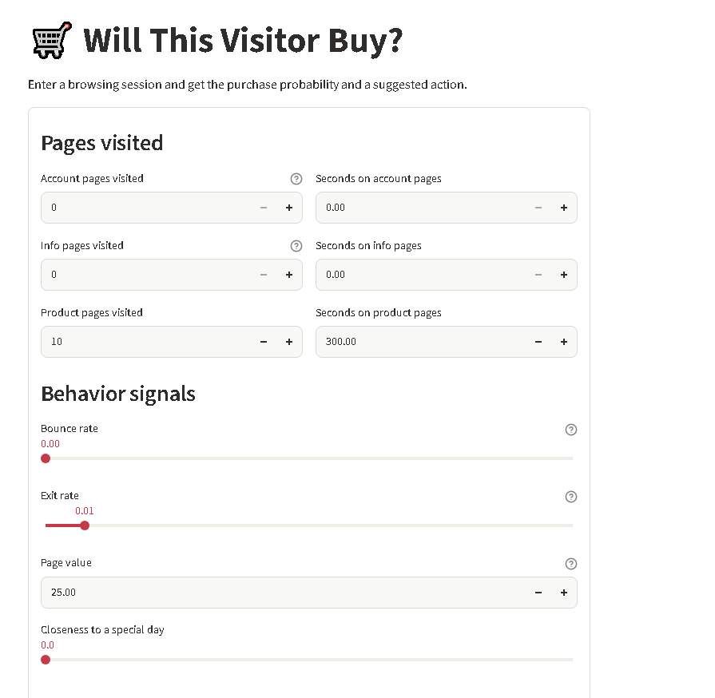
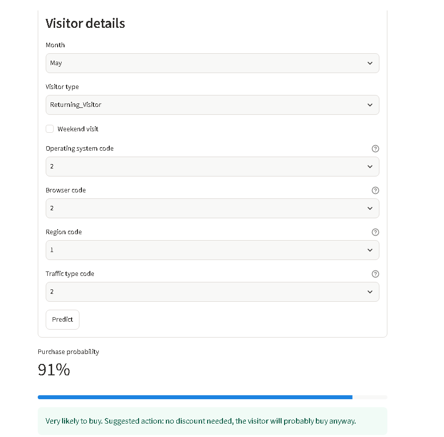

# Will This Visitor Buy? Purchase Intent Predictor

Most online shoppers leave without buying. This app predicts, during a browsing session, whether a visitor will purchase, so a store can show a chat assistant or a small coupon only to the visitors who need it.

**Live app:** https://purchase-intent-app-prapkky4npbpzbjw6n9h7e.streamlit.app




## Results

Evaluated once on an untouched test set (2,441 sessions, 382 buyers).

| Model | Recall | Precision | PR-AUC |
|---|---|---|---|
| Baseline (always "no purchase") | 0.00 | 0.00 | about 0.16 |
| Tuned Random Forest (threshold 0.5) | 0.83 | 0.57 | 0.75 |
| Tuned Random Forest (threshold 0.4, used in the app) | 0.87 | 0.51 | 0.75 |

The decision threshold (0.4) was chosen on out-of-fold training predictions, not on the test set.

## What I did

- Cleaned the data (removed 125 duplicates) and explored it with univariate, bivariate and multivariate analysis.
- Built a scikit-learn Pipeline (log transform, scaling, one-hot encoding) fitted on the training set only to avoid leakage.
- Compared Logistic Regression, Decision Tree and Random Forest with 5-fold stratified cross-validation, then tuned the Random Forest with randomized search (optimizing PR-AUC).
- Handled the class imbalance (15.6% buyers) with class weights and judged models by recall, precision and PR-AUC instead of accuracy.

## Limitations

- `PageValues` drives most predictions, so buyers who purchase without visiting high-value pages are missed.
- The data covers 10 months (January and April are missing).
- The data cannot show whether a coupon changes behavior, so the extra sales from an intervention are not measured.

## Run locally

```bash
pip install -r requirements.txt
streamlit run app.py
```

## Data

Online Shoppers Purchasing Intention dataset, UCI Machine Learning Repository: https://archive.ics.uci.edu/dataset/468
